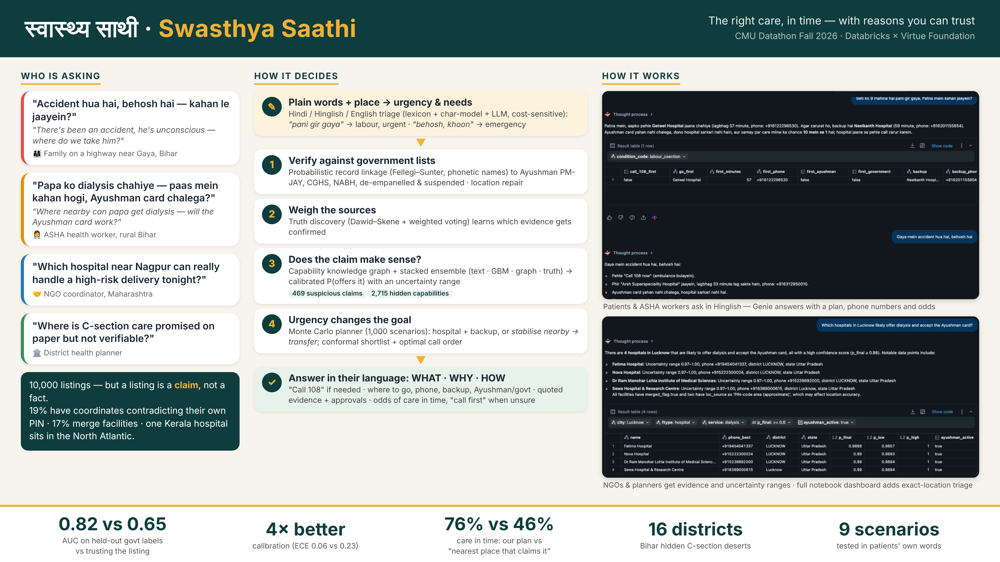
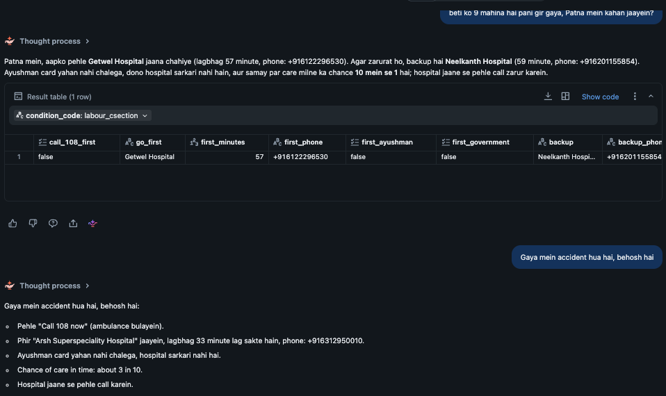
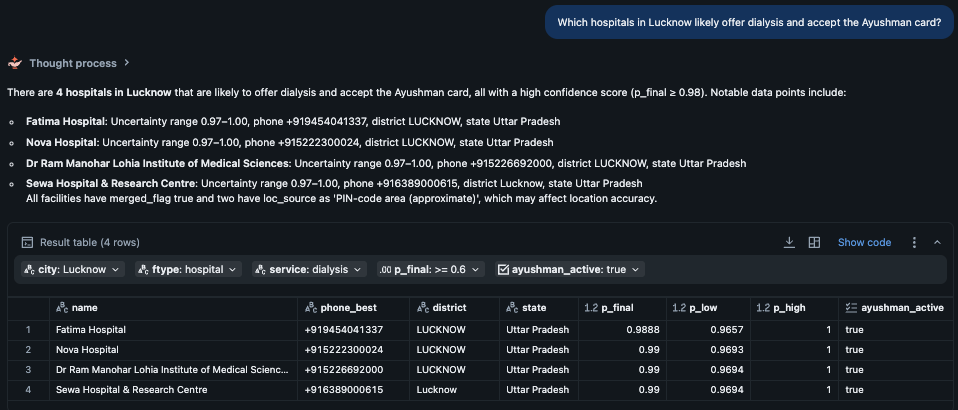
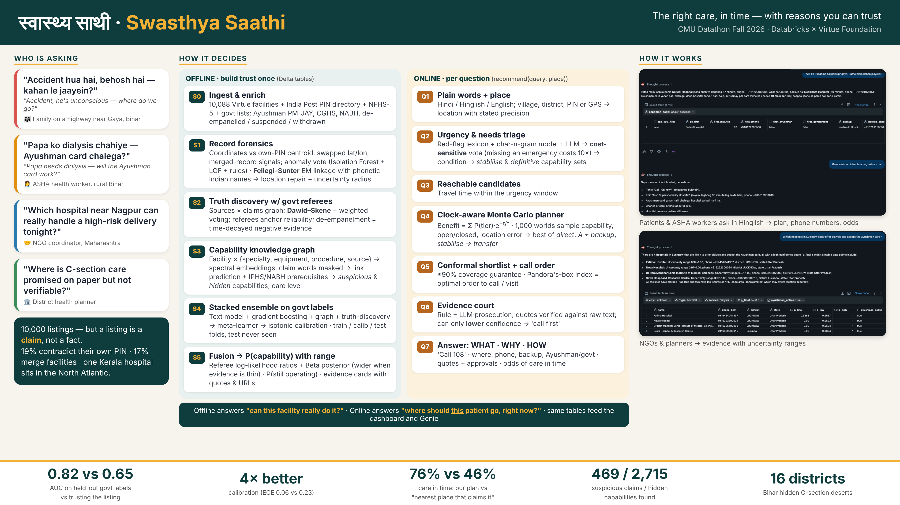

# स्वास्थ्य साथी · Swasthya Saathi

### The right care, in time — with reasons you can trust

**CMU Datathon Fall 2026 · Databricks × Virtue Foundation · "Find the right care" challenge**



🎬 **Demo video (2 min):** [▶ Watch on YouTube](https://youtu.be/TXWzxnP8u2Q) · 🧭 **Pipeline explainer video:** [▶ saathi_pipeline_explainer.mp4](images/saathi_pipeline_explainer.mp4)

[](https://youtu.be/TXWzxnP8u2Q)

> *"Accident hua hai, behosh hai — kahan le jaayein?"* (There's been an accident, he's unconscious — where do we go?)
>
> *"Papa ko dialysis chahiye — Ayushman card chalega?"* (Papa needs dialysis — will the Ayushman card work?)

Swasthya Saathi (Hindi for "health companion") takes a **need, in plain words**, and a **location**, and returns the facility to go to, a backup, phone numbers, cost or insurance status, and the **odds of getting care in time**. Every recommendation says **WHY** (cited facility text and government approvals) and **HOW** (the scoring, the model and the trade-offs). When the evidence is weak, it says so.

---

## Table of contents
1. [The problem](#1-the-problem)
2. [Who it's for](#2-who-its-for)
3. [Demo](#3-demo)
4. [Approach](#4-approach)
5. [Results](#5-results)
6. [Data sources](#6-data-sources)
7. [Repository structure](#7-repository-structure)
8. [How to run](#8-how-to-run-databricks-free-edition)
9. [Genie space setup](#9-genie-space-setup)
10. [How the challenge requirements are met](#10-how-the-challenge-requirements-are-met)
11. [Limitations & next steps](#11-limitations--next-steps)
12. [Team](#12-team)

---

## 1. The problem

The Virtue Foundation dataset lists **10,088 healthcare facilities across India**, but almost every field was extracted from web text. A listing is a **claim, not a fact**. Our exploratory analysis found:

| Data issue | Finding |
|---|---|
| Coordinates contradicting the facility's own PIN code (>25 km away) | **19.3%** of records |
| Records that look like **merged facilities** (multiple source IDs, PINs, phone clusters) | **16.7%** |
| Records with more than one source ID | **64%** |
| Coordinates outside India / missing | 6 / 118 (e.g. a Kerala hospital placed in the North Atlantic) |
| Capacity (beds) known | ~25% |

A confident wrong answer costs a patient hours they don't have. So we treat every listing as a **hypothesis to be tested** against independent evidence.

---

## 2. Who it's for

| User | Need | Interface |
|---|---|---|
| 👨‍👩‍👧 Family / patient attendant (often rural, Hindi-speaking, stressed) | "Where do I go *now*?" | Notebook **dashboard** (plain-words input → Hindi action plan) and **Genie** |
| 👩‍⚕️ ASHA / community health worker | Dialysis, delivery, newborn care near the village, with Ayushman card | Dashboard + Genie |
| 🤝 NGO coordinator | Reliable hospitals for a specific service, with evidence | Genie |
| 🏛️ District health planner | Where is care promised but not verifiable? | Genie over `district_access` |

---

## 3. Demo

🎬 **Full walkthrough video (2 min):** [▶ YouTube](https://youtu.be/TXWzxnP8u2Q). It covers the approach, the notebook dashboard and the Genie agent.

### Patient / field-worker flow (notebook dashboard)

Input: *"papa ke pair sooj gaye, doctor ne dialysis bola"*, location *Jaipur*. Output: a Hindi action plan first (where to go, phone number, backup, Ayushman status, odds), then the full English **WHY / HOW**.

### Genie agent (patients, NGOs, planners)


| Patient-style questions in Hinglish | NGO / planner questions |
|---|---|
|  |  |

Example questions that work in Genie:
- *"beti ko 9 mahina hai pani gir gaya, Patna mein kahan jaayein?"* (labour → hospital, backup, phone, odds)
- *"Gaya mein accident hua hai, behosh hai"* (→ "Call 108 now", then the hospital)
- *"Which hospitals in Lucknow likely offer dialysis and accept the Ayushman card?"*
- *"Which districts in Bihar have no verified C-section facility within 2 hours?"* (→ hidden care deserts)

---

## 4. Approach



### 🧭 Pipeline explainer (2 min)
[](images/saathi_pipeline_explainer.mp4)

*Click the animation for the full-quality video.*

The system has two halves.
- **Offline** builds trust in the data once and writes it to Delta tables. It answers *"can this facility really do it?"*
- **Online** runs per question. It answers *"where should **this** patient go, right now?"*

The dashboard and Genie both read the same tables, so they always agree.

```
OFFLINE (build trust once → Delta tables)            ONLINE  recommend(query, place)
S0 Ingest: Virtue + PIN directory + NFHS-5           Q1 Plain words + place → location (with stated precision)
   + govt lists (PM-JAY, CGHS, NABH, de-empanelled)  Q2 Urgency & needs triage (ensemble, cost-sensitive)
S1 Record forensics + probabilistic linkage          Q3 Reachable candidates (travel time within urgency window)
S2 Truth discovery with government referees          Q4 Clock-aware Monte Carlo planner (backup / stabilise→transfer)
S3 Capability knowledge graph (link prediction)      Q5 Conformal shortlist + optimal call order
S4 Stacked ensemble trained on government labels     Q6 Evidence court (verified quotes, can only lower confidence)
S5 Fusion → P(capability) with uncertainty range     Q7 Answer: WHAT · WHY · HOW in the user's language
```

### Offline: can this facility really do it?

**S0 · Ingest & enrich.** We combine:
- the 10,088 Virtue facilities, parsing JSON list fields and turning camelCase specialty codes into text;
- the India Post PIN directory, aggregated to one centroid per PIN to avoid fan-out;
- NFHS-5 district indicators;
- government "referee" lists: **Ayushman Bharat PM-JAY** empanelled hospitals, with specialties where published; **CGHS** Delhi NCR, with the services each hospital is empanelled for; **NABH** accreditation; and Haryana **de-empanelled / suspended / withdrawn** lists.

We also classify every source URL as own website, government, directory, social, irrelevant (real-estate, restaurant pages) or other.

**S1 · Record forensics + linkage.**
- *Geo checks:* coordinates vs the facility's own PIN centroid, swapped lat/lon, points outside India.
- *Merged-record signals:* multiple source IDs, PINs in the text, phone-number clusters, village or place pages.
- *Anomaly vote:* Isolation Forest + Local Outlier Factor + rules (e.g. a NICU claim from a facility with 3 doctors). A record is flagged at 2 of 3 votes.
- *Probabilistic record linkage* (**Fellegi–Sunter, fitted with EM, no labels**): matches Virtue records to the government lists using **phonetic name similarity tuned for transliterated Indian names** (Sanjivani ≈ Sanjeevani), phone, PIN and distance. Every link carries a `link_prob`.
- *Location repair:* registry coordinates → swapped-back → original (if consistent) → PIN centroid → district centre. Each facility gets an **uncertainty radius** that the planner uses.

**S2 · Truth discovery with government referees.** This is a sources × claims voting model.
- *Voters:* the record's fields (specialties, procedures, equipment, capabilities, description), its web-source types, its pipeline source types, and the **government referees**.
- *Algorithms:* **Dawid–Skene (EM)** plus iterative accuracy-weighted voting, combined as an ensemble. Referees get strong but *estimated* reliability priors. De-empanelment is negative evidence that fades with time; voluntary withdrawal is not treated as a penalty.
- *Leakage control:* reliabilities are learned from the **train-fold** referees only, and the score used as a feature (`p_td_web`) uses web evidence alone.

**S3 · Capability knowledge graph.**
- *Graph:* facilities ↔ {specialty codes, equipment, procedure and capability terms, source types}.
- *Embeddings:* spectral (truncated SVD), learned **per service with that service's own words masked**, so the model has to infer the capability from the rest of the profile.
- *Link prediction:* out-of-fold P(facility → service). A claim with a low score is **suspicious**; a missing claim with a high score is a **hidden capability**.
- *Rules check the model:* IPHS/NABH-style **prerequisite sets** (a C-section needs anaesthesia, an operating theatre and a blood bank).
- *Explanations:* features with the highest lift for the service ("pattern: nephrology, RO plant → 92% of similar facilities list dialysis").
- *Care level* (primary / secondary / tertiary): inferred even when bed counts are missing, using k-NN on the embedding.

**S4 · Stacked ensemble trained on government labels.**
- *Labels:* PM-JAY / CGHS specialty approvals for linked facilities (990 labelled facility × service rows).
- *Base learners:* a per-service **text model** (TF-IDF + logistic regression) and a pooled **gradient-boosting model** on scale, claims, prerequisites, source mix, activity signals, forensics flags, `p_kg` and `p_td_web`.
- *Combination:* a **logistic meta-learner** trained on out-of-fold predictions, then **isotonic calibration** on a separate calibration fold. **All metrics are on a test fold never seen by S2 or S4.** SHAP explains each prediction.

**S5 · Fusion.**
- *Probability:* the calibrated model output is combined with the referees' learned log-likelihood ratios to give `p_final`.
- *Range:* a **Beta posterior** whose width shrinks with the amount of independent evidence gives `p_low` and `p_high`. Thinly documented facilities get wide ranges.
- *Also computed:* **P(still operating)** from website freshness, social activity and scheme status, plus an **evidence card** per facility × service: quotes from the record, government badges, graph pattern, model drivers and URLs.

### Online: where should this patient go, right now?

**Q1 · Location.** Accepts `lat,lon`, a 6-digit PIN, or a district, city or post-office name (Devanagari city names supported). It always reports *how* the place was resolved and how precise that is.

**Q2 · Urgency & needs triage.**
- *Ensemble:* a red-flag dictionary (English, Hinglish, Devanagari), a character n-gram classifier and an optional AI model, combined by **cost-sensitive Bayes decision**. Missing an emergency costs up to 10× more than over-triage, so it escalates when in doubt.
- *Output:* probabilities over the urgency tiers (immediate / urgent / soon / planned), plus a condition with **stabilise** and **definitive** capability sets. For example, bleeding after delivery → stabilise {24/7 emergency, blood}; definitive {obstetric surgery, blood bank}.

**Q3 · Reachable candidates.** Only facilities within the urgency window. Travel time ≈ straight-line distance × 1.35 road factor at 35 km/h, plus 5 minutes to depart.

**Q4 · Clock-aware Monte Carlo planner.**
- *Benefit:* reaching care after *t* minutes is worth `Σ_tier P(tier) · exp(−t/τ)`. The clock τ comes from the condition (trauma ≈ golden hour, heart attack ≈ 90 min, dialysis ≈ a day, MRI ≈ weeks), and urgency is a **mixture**, not a switch.
- *Simulation:* 1,000 worlds, each sampling whether each facility really has the capability (from its Beta posterior), whether it is open, and travel-time error scaled by location uncertainty.
- *Plans compared:* **direct**, **A then backup B**, and **stabilise at S, then transfer to D**. It reports P(care within the window) and how often the chosen plan is best (within 5%) across worlds.

**Q5 · Conformal shortlist + optimal call order.** **Split conformal prediction**, calibrated on the calibration fold, gives a shortlist that contains a facility truly offering the service with a target probability. The target depends on urgency: 80% for emergencies, up to 95% for planned care. The order to call or visit uses **Weitzman's Pandora's-box index** (σ = v − c/p), which is provably optimal for this kind of sequential search.

**Q6 · Evidence court.** A rule-based "prosecution" runs on every recommendation: de-empanelment, specialty not covered by the government list, stale website, location conflict, merged record, out-of-proportion claims, negated mentions. It is optionally joined by an AI defence and prosecution whose **quotes are verified in code against the raw record**. The court can only **lower** confidence and add a **"call first"** flag; it can never raise a score.

**Q7 · Answer.**
- *Emergencies:* "Call 108 (102 for pregnancy)" comes first.
- *Every answer:* where to go, travel time, phone, backup, Ayushman / government status, and the odds in words ("about 3 in 10").
- *WHY:* quoted record text with its field, government approval badges, the graph pattern and model drivers.
- *HOW:* the urgency tier, the clock used, the plan type and the trade-off ("we did not recommend the nearest place that claims it because its evidence is unlikely").
- *Language:* Hindi or Hinglish queries get a Hindi action plan on top.

---

## 5. Results

All capability metrics are on a **held-out test fold of government-labelled facilities** (gold labels, n = 242 facility × service rows).

| Model | AUC ↑ | Brier ↓ | ECE ↓ |
|---|---|---|---|
| Baseline: trust what the record claims | 0.645 | 0.274 | 0.231 |
| Truth discovery (web evidence only) | 0.628 | 0.331 | 0.331 |
| Knowledge-graph link prediction | 0.737 | 0.226 | 0.231 |
| Text model | 0.675 | 0.226 | 0.190 |
| Structure gradient boosting | 0.812 | 0.158 | 0.134 |
| **Stacked + calibrated (ours)** | **0.818** | **0.129** | **0.064** |

| Other results | Value |
|---|---|
| **Planner vs. baselines**: P(care within the time window), trauma, simulated across sampled locations | **0.76** vs 0.46 (nearest place that claims it) vs 0.21 (biggest hospital) |
| Harm audit: how often the "nearest place that claims it" pick was misleading (de-empanelled / bad location / weak evidence) | 42–97%, depending on condition |
| Suspicious claims found (claim doesn't fit the capability pattern) | **469** |
| Hidden capabilities found (fits the pattern, not listed) | **2,715** |
| Bihar districts that are **hidden C-section deserts** (claims suggest care within 1 h, nothing verified within 2 h) | **16** |
| Records linked to government lists | 273 (76 PM-JAY, 96 CGHS, 63 NABH, 38 de-empanelled/withdrawn rows) |
| Triage missed-emergency rate (leave-one-out, preliminary) | 5.6% |
| Patient-voice scenario tests (realistic Hinglish/Hindi queries checked for urgency, service, "108", phone, time, uncertainty) | 9 scenarios |
| Conformal coverage on test fold (target 80% / 90% / 95%) | 78% / 84% / 87%: close to target, limited by label count |

**Source reliability, an honest finding:** against government lists, claims appearing in **procedures** were confirmed most often (~40%), then specialties (~35%), with **equipment** lists the least reliable (~17%).

---

## 6. Data sources

| Source | Use | Licence |
|---|---|---|
| Virtue Foundation facility dataset (Databricks Marketplace) | Core dataset (10,088 facilities, 51 attributes) | Per Marketplace listing |
| India Post PIN Code Directory (data.gov.in) | Geocoding, location repair, district assignment | GODL-India |
| NFHS-5 District Health Indicators (data.gov.in) | District need context (C-section rate, institutional births, anaemia) | GODL-India |
| **Ayushman Bharat PM-JAY** empanelled hospital lists (district and state health agency sites: Lucknow, Ballia, Etawah, Ambala, Rewari, Kaithal, Seraikela-Kharsawan) | Referee labels, "Ayushman card accepted" | Public government documents |
| **CGHS** Delhi NCR empanelled hospitals (2022) | Referee labels (services empanelled for), NABH status | Public government documents |
| Haryana PM-JAY / CCHF **de-empanelled, suspended, withdrawn** lists | Negative evidence, "no longer accepts the card" | Public government documents |

The extracted, cleaned CSVs are in [`government_lists/`](government_lists/). One scanned list (Agra) was excluded because OCR could not reliably recover the hospital IDs.

---

## 7. Repository structure

```
├── saathi_care_finder.ipynb        # The full pipeline (single notebook, with outputs)
├── government_lists/               # Cleaned referee CSVs (upload to the Databricks volume)
│   ├── pmjay_*.csv                 #   Ayushman PM-JAY empanelled hospitals
│   ├── state_cghs_delhi_ncr.csv    #   CGHS empanelled hospitals + services
│   ├── nabh_delhi_ncr_from_cghs.csv
│   └── deempanel_*.csv             #   de-empanelled / suspended / withdrawn
├── images/
│   ├── swasthya_saathi_slide_final.png        # overview slide
│   ├── swasthya_saathi_slide_supp.png         # detailed offline / online pipeline
│   ├── genie_patient_chat.png
│   ├── genie_planner_chat.png
│   ├── swasthya_saathi_gif_genie.gif          # Genie agent demo
│   ├── saathi_pipeline_explainer.mp4          # pipeline explainer video
│   └── saathi_pipeline_explainer.gif          # same, as an embedded animation
└── README.md
```

---

## 8. How to run (Databricks Free Edition)

1. **Get the data:** in the Databricks Marketplace, open *Virtue Foundation Dataset (DAIS 2026)* and choose **Get instant access**. The catalog is `databricks_virtue_foundation_dataset_dais_2026`.
2. **Import the notebook:** Workspace → your folder → ⋮ → Import → `saathi_care_finder.ipynb`. Attach **Serverless** compute.
3. **Create the schema and volume:** run the first three cells. This creates `workspace.care_finder` and the volume `workspace.care_finder.external`.
4. **Upload the referee lists:** Catalog → workspace → care_finder → Volumes → external → **Upload**, then add every CSV from `government_lists/`. File-name prefixes (`pmjay_`, `state_`, `deempanel_`, `nabh_`, `pmndp_`) tell the loader what each file is.
5. **Config:** in the config cell, set `USE_LLM = False` (fastest), or point `LLM_ENDPOINT` to a chat model endpoint available in Serving.
6. **Run all.** About 10–15 minutes on serverless. The cell after the referee lists should print `referee mode: GOLD`. Without the CSVs, the pipeline still runs in SILVER mode, using self-consistent labels.
7. **Use it:**
   - **Dashboard:** the last cell creates widgets (*what happened*, *where are you*, *need free/Ayushman care*). Use **View → Dashboard** for a no-code view.
   - **In code:** `recommend("Delivery ke baad bahut khoon beh raha hai", "Muzaffarpur")`
8. **Output tables** (in `workspace.care_finder`):

| Table | Contents |
|---|---|
| `facility_clean` | Repaired locations, registry flags, care level, P(open), forensics flags |
| `capability_scores` | Facility × service: `p_final`, `p_low`, `p_high`, component scores, referee vote |
| `district_access` | Minutes to stabilising / verified / claimed care per district + NFHS-5 |
| `district_referral_plans` | Precomputed referral plans per district × condition (for Genie) |
| `source_reliability`, `suspicious_claims`, `hidden_capabilities`, `model_metrics`, `planner_benchmark`, `registry_links` | Audit and evaluation tables |

---

## 9. Genie space setup

1. **Genie → New**, using the Serverless Starter Warehouse.
2. **Add tables** from `workspace.care_finder`: `facility_clean`, `capability_scores`, `district_access`, `district_referral_plans`, `source_reliability`, `suspicious_claims`, `hidden_capabilities`, `model_metrics`.
3. **Instructions** (summary; the full text is in the notebook's last markdown cell):
   - A facility "offers" a service only if `p_final ≥ 0.6`. Between 0.4 and 0.6, say "possible, call to confirm". Always show `p_low`–`p_high`.
   - Mention Ayushman acceptance, government status, NABH and de-empanelment. Warn about approximate locations and merged records.
   - Patient questions map to `condition_code` in `district_referral_plans`. Answer with "Call 108" first when urgent, then the hospital, phone, backup and odds, in Hindi if the user writes in Hindi.
   - Boolean columns are stored as text `'True'` / `'False'`. Never invent facilities or phone numbers.
4. Add the example questions from [Demo](#3-demo) as **Examples**, with their SQL.

> Genie spaces are only accessible to users of the workspace. The screenshots, GIF and demo video above show the live agent.

---

## 10. How the challenge requirements are met

| Requirement | How |
|---|---|
| Runs on Databricks Free Edition | Serverless notebook, Delta tables, Genie space |
| Uses the provided dataset | The core of every stage; external lists only *verify* it |
| Two inputs → best facilities | `recommend(need, place)`, the dashboard widgets and Genie |
| **WHY this facility?** | Exists: registry link plus repaired location. Offers it: quoted record text, government approvals, graph pattern, model drivers. Best choice: travel time, backup and odds vs alternatives |
| **HOW did you decide?** | Urgency tier, clock τ, Monte Carlo plan comparison, conformal shortlist and "not the nearest because…" trade-offs, printed with every answer |
| Non-technical workflow | Plain Hindi/Hinglish input; a 3-line Hindi action plan first; "Call 108"; tap-to-call phone numbers; Genie chat |
| Cites facility text | Every claim in WHY quotes the record field and links source URLs |
| Communicates uncertainty | `p_low`–`p_high` ranges, "about N in 10", "call first", wide ranges for thin evidence, location precision, a warning when nothing well-evidenced is reachable |

---

## 11. Limitations & next steps

**Limitations (stated honestly)**
- **Travel time** is straight-line × road factor, not real routing.
- **Clocks (τ)** and the stabilisation factor are literature-informed assumptions.
- **Multiple capabilities** needed for one condition are treated as independent.
- **Government labels** cover a limited set of districts (UP, Haryana, Jharkhand, Delhi NCR), and specialty-level labels come from Ambala, Seraikela and CGHS only.
- **Conformal coverage** is slightly under target on the small test fold.
- **Triage** was evaluated on 42 written queries; the missed-emergency rate is preliminary.
- **Rare services** (e.g. anti-snake venom) are rarely listed, so recommendations for them rest on stabilisation capacity.
- **Truth discovery** collapses on correlated web-source voters, so we report empirical confirmation rates instead.
- **District plans** in Genie are computed from district centres; the dashboard uses the patient's exact location.

**Next steps**
- **Voice:** speech in and out (e.g. via Bhashini) for low-literacy users. The input is already plain text.
- **More referee lists:** every state's PM-JAY and state-scheme lists (with specialties), PMNDP dialysis centres, and OpenStreetMap emergency tags.
- **Routing:** road-network travel time (OSRM or the Malaria Atlas Project friction surface) and population-weighted golden-hour maps (WorldPop).
- **Field testing:** with ASHA workers and patients' families, to calibrate wording and triage.
- **A Databricks App** for a mobile-friendly link outside the workspace.

---

## 12. Team

Chaitanya Peshin, Upendra Yanamandra, Rahul Krishna

*Built for the CMU Databricks Datathon Fall 2026. Facility data © Virtue Foundation; public government data under the Government Open Data License – India where applicable. Swasthya Saathi is a decision-support prototype, not medical advice: in an emergency, call **108**.*
