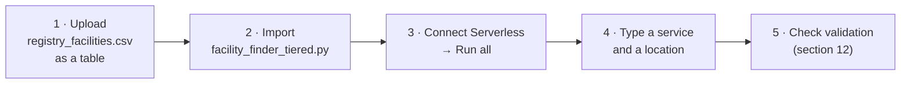
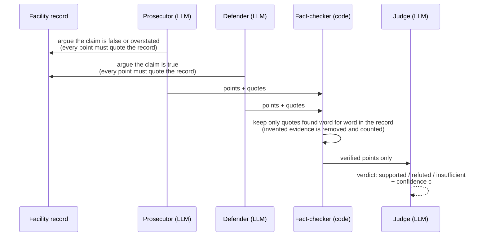

# Facility Finder: evidence-based healthcare facility recommendations for India

**CMU Datathon Fall 2026 · Virtue Foundation India dataset · runs on Databricks Free Edition**

You give it a **service** ("my wife is in labour and bleeding", "dialysis", "chemotherapy for my father") and a **location** (a city, district, village, 6-digit PIN code or `lat,lon`). It returns the **best few facilities**. Every option answers two questions in plain language:

- **WHY this facility?** Quoted evidence that it exists, that it offers the service, and that it suits where you are.
- **HOW did you decide?** The model used, its numbers and weights, and the trade-offs it made.


---

## Contents

1. [The idea in four sentences](#the-idea-in-four-sentences)
2. [What's in this repository](#whats-in-this-repository)
3. [Quick start (Databricks Free Edition)](#quick-start-databricks-free-edition)
4. [How it works](#how-it-works)
   - [Step 0 · Triage: how urgent is this?](#step-0--triage-how-urgent-is-this)
   - [Step A · Where is the patient, and where are the facilities really?](#step-a--where-is-the-patient-and-where-are-the-facilities-really)
   - [Step 1 · The Claim Court: does this facility really offer the service?](#step-1--the-claim-court-does-this-facility-really-offer-the-service)
   - [Step 5 · The registry: a second, independent witness](#step-5--the-registry-a-second-independent-witness)
   - [High tier · Monte-Carlo Plan A / Plan B router](#high-tier--monte-carlo-plan-a--plan-b-router)
   - [Medium tier · Access, need and crowding model](#medium-tier--access-need-and-crowding-model)
   - [Low tier · The LLM Evidence Court](#low-tier--the-llm-evidence-court)
   - [The WHY / HOW cards](#the-why--how-cards)
5. [Validation](#validation)
6. [Data sources](#data-sources)
7. [Configuration](#configuration)
8. [Troubleshooting](#troubleshooting)
9. [Limitations, stated honestly](#limitations-stated-honestly)

---

## The idea in four sentences

1. A listing in a directory is a **claim**, not a fact. About 1 in 5 records in this dataset have map coordinates that contradict their own PIN code, and many "hospitals" list services they don't provide.
2. So every facility is put on trial: a **Claim Court** turns quoted evidence into a probability that it really offers the service, and an **official government list** (LaQshya) acts as an independent witness.
3. How we pick the winner depends on **how urgent the need is**: minutes for a haemorrhage, days for dialysis, weeks for cancer care. Each urgency level gets a model built for that kind of decision.
4. Nothing is a black box. Every recommendation comes with the quotes, probabilities and weights behind it.

## What's in this repository

| File | What it is | Do you need it? |
|---|---|---|
| `facility_finder_tiered.py` | The whole pipeline as one Databricks notebook (Python source format) | **Yes** |
| `registry_facilities.csv` | LaQshya certification list: 2,173 rows (labour rooms and maternity operation theatres) across 32 states/UTs | **Recommended** (the notebook runs without it, but loses its strongest evidence) |
| `convert_laqshya.py` | Script that produced the CSV from the official LaQshya PDF, so you can rebuild it when a new list is published | Only to refresh the registry |
| `district_population_template.csv` | Template for an optional district-population table | Optional |
| `docs/img/*.svg` | The illustrations in this README | No |

The notebook also reads three tables that are already in the hackathon workspace:

| Table | Role |
|---|---|
| `…virtue_foundation_dataset.facilities` | ~10,000 facility listings: the claims we verify and rank |
| `…virtue_foundation_dataset.india_post_pincode_directory` | Geography: turns a PIN, district or village into points on a map |
| `…virtue_foundation_dataset.nfhs_5_district_health_indicators` | District health context (NFHS-5), used to measure local need |

(`…` = `databricks_virtue_foundation_dataset_dais_2026`)

## Quick start (Databricks Free Edition)



**1. Upload the registry.** In Databricks, open **Catalog** in the left sidebar → **+ / Add data** → **Create or modify table / Upload file**. Choose `registry_facilities.csv` and set:

| Setting | Value |
|---|---|
| Catalog | `workspace` |
| Schema | `default` |
| Table name | `registry_facilities` |

Check that the preview shows columns such as `registry`, `facility_name`, `state` and `district`, then click **Create table**.

**2. Import the notebook.** Go to **Workspace**, open your folder (or Git folder), use the **⋮** menu or right-click → **Import**, and upload `facility_finder_tiered.py`. Databricks recognises the file as a notebook.

**3. Run it.** Open the notebook, click **Connect** (top right), choose **Serverless** (CPU is enough; nothing here needs a GPU), then **Run all**. The first run takes a few minutes. These printed lines tell you it worked:

| Section | What to look for |
|---|---|
| 2 · Geography | post-office counts, including how many swapped coordinates were fixed |
| 3 · Facilities | facility count and how many have valid coordinates |
| 4 · NFHS | the district-matching rate (a low rate means a lot of districts get no NFHS context) |
| 6 · Registry | `registry rows: 2,173 from 3 registries: …` |
| 11 · Run a query | which AI model it connected to, or `rule-based Evidence Court` |

**4. Ask questions.** Type a service and a location into the two boxes at the top of the notebook. Then click into **section 11** and press **Shift + Enter**.

> **Why doesn't changing the code change the answer?** `dbutils.widgets.text(...)` only sets a widget's *default* the first time it runs. After that, the widget keeps whatever is typed in the box. Type in the box itself.

**5. Validate.** Section 12 runs a test query for every tier plus edge cases (an unknown service, an unknown town). If the registry is loaded, it also produces the validation table described [below](#validation).

**6. (Optional)** Section 13 saves results to `workspace.default.facility_recommendations`, ready for a dashboard or a Genie space.

If your session goes idle and in-memory data is lost, choose **Run all** again before asking more questions.

## How it works

The notebook is organised as numbered sections. The tags in brackets (`[0]`, `[A]`, `[1]`, `[5]`) match the labels in the overview picture.

| Section | Does what |
|---|---|
| 0–1 | Configuration and small helpers (text cleaning, distances) |
| 2 `[A]` | Cleans the India Post PIN directory into a geography layer |
| 3 | Loads the facilities and scores each one's **location validity** |
| 4 | Parses NFHS-5 and bridges its district names to India Post's |
| 5 `[0]` | **Triage**: service text → High / Medium / Low |
| 6 `[5]` | **Registry** matching (record linkage) |
| 7 `[1]` | Evidence extraction and the **Claim Court** |
| 8 | Turns the user's location into a cloud of possible points |
| 9 | The **three tier models** |
| 10 | Orchestration and the WHY / HOW cards |
| 11 | Run a query |
| 12 | Scenario tests and validation |
| 13 | Optional export |

### Step 0 · Triage: how urgent is this?

Criticality here means **how time-critical the need is**. No Indian dataset labels services that way, and asking an LLM to guess would be neither reproducible nor citable. So the notebook uses the number clinicians use: **the maximum safe delay before treatment**, taken from published guidance. The tier follows directly from it.


How the text is read:

- **Catalog matching.** Free text is matched to a catalog of services by keywords and fuzzy matching. Cancer words are caught by their suffixes (`…carcinoma`, `…sarcoma`, `…lymphoma`, `…blastoma`, …), so "adenosarcoma check-up" correctly becomes cancer care.
- **Upgrades.** Urgency words (*bleeding, accident, unconscious, labour pain, chest pain, emergency*) move the request up a tier, or to an emergency variant: dialysis → emergency dialysis, cardiac → heart attack.
- **Downgrades.** Planning words (*scheduled, routine, follow-up*) can move Medium → Low, but **never downgrade High**. Treating an emergency as routine costs far more than the reverse, so the asymmetry is deliberate and is stated in the output.
- **Unknown services.** These get a time window estimated by an LLM, bounded and labelled as an estimate. If that fails too, they default to Medium with a warning.

Every window records how strong its source is, and that strength is shown to the user:

| Service | Window | Strength | Source |
|---|---|---|---|
| Trauma | 1 h | convention ("golden hour", weakly evidenced) | [PMC3008652](https://pmc.ncbi.nlm.nih.gov/articles/PMC3008652) |
| Emergency C-section | 1 h | guideline (NICE: decision-to-delivery ≤ 30 min) | [NICE NG192](https://www.nice.org.uk/guidance/ng192) |
| Bleeding after childbirth | 2 h | evidence (postpartum haemorrhage) | [WHO](https://www.who.int/publications/i/item/9789240081802) |
| Sick newborn (NICU) | 1 h | evidence (neonatal golden hour) | [PMC5604187](https://pmc.ncbi.nlm.nih.gov/articles/PMC5604187) |
| Burns | 2 h | evidence (fluid resuscitation delay) | [PMC4057496](https://pmc.ncbi.nlm.nih.gov/articles/PMC4057496) |
| Heart attack (STEMI) | 90 min | guideline (ACC/AHA) | [AHA](https://professional.heart.org/en/science-news/2013-guideline-for-the-management-of-st-elevation-myocardial-infarction/commentary) |
| Stroke | 4.5 h | guideline (AHA/ASA thrombolysis) | [AHA/ASA](https://stroke.org/-/media/Stroke-Files/Ischemic-Stroke-Professional-Materials/AIS-Toolkit/Guidelines-for-Mangaging-Patients-with-AIS-2019-Update-to-2018-Guidelines.pdf) |
| ICU | 4 h | evidence (ICU admission delay) | [PMC4175615](https://pmc.ncbi.nlm.nih.gov/articles/PMC4175615) |
| Emergency dialysis | 6 h | guideline + **our assumption** for the hour limit (KDIGO) | [PMC4089702](https://pmc.ncbi.nlm.nih.gov/articles/PMC4089702) |
| Maintenance dialysis | 2 days | evidence (deaths rise after the 2-day gap) | [Foley 2011, NEJM](https://pubmed.ncbi.nlm.nih.gov/21992122/) |
| Cancer care | ~4 weeks | evidence (each 4-week delay raises mortality) | [Hanna 2020, BMJ](https://www.bmj.com/content/371/bmj.m4087) |
| CT, MRI, cardiac surgery, high-risk delivery | 1 day – 2 weeks | **our assumption** | — |

### Step A · Where is the patient, and where are the facilities really?


**Cleaning the geography.** The India Post directory has swapped latitude/longitude pairs and points outside India. These are fixed or dropped. Each PIN code then gets a centre point and a radius.

**Location validity.** For each facility, the notebook measures how far its map pin is from the centre of its own PIN code, in units of that PIN's radius, and turns that distance into a probability that the pin is right. A small PIN in a city and a huge rural PIN are judged fairly this way.

**The user's location** is not a single point either. "Jaipur" covers hundreds of square kilometres, so it becomes a *cloud* of post-office points. A PIN is a small cloud, and `lat,lon` is a point. If a name exists in several states, the notebook picks the one with the most data and **says so**, listing the alternatives. Add `, State` to disambiguate, e.g. `Aurangabad, Bihar`.

### Step 1 · The Claim Court: does this facility really offer the service?

This is used by **every** tier. The hypothesis on trial is *"facility f offers service s"*.

The court starts from a base rate (prior) set by facility type. Each piece of evidence (a *witness*) then multiplies the odds by a **likelihood ratio (LR)**. In log-odds, that's just addition:

$$\log\frac{p}{1-p} \;=\; \log\frac{p_0}{1-p_0} \;+\; \sum_i \log LR_i$$


Why the witnesses have different strengths:

| Witness | LR | Reason |
|---|---|---|
| Prior: hospital / clinic / unknown | p₀ = 0.25 / 0.05 / 0.12 | the base rate for that type |
| Claim in the **procedure** field | ×6 | a concrete claim about work performed |
| Claim in **equipment** / **capability** | ×5 | hard to claim casually |
| Claim in **description** | ×2.5 | marketing text, easily inflated |
| Claim in **specialties** | ×1.8 | a broad category |
| Agreement across ≥ 2 independent fields | ×1.5 | the best signal available without labels |
| ≥ half of the service's **capability bundle** present (e.g. for C-section: OT, anaesthesia, blood bank, newborn care, obstetrician, 24×7) | ×1.5 | it can actually deliver the service |
| **Official registry confirms this service** (current) | ×10 | independent and government-checked |
| Registry confirms, but expired or conditional | ×4 | the unit was assessed; its status may have lapsed |
| District context (NFHS private C-section rate), surgical obstetrics only | ×0.8–1.25 | local base rate |
| Negation ("no dialysis", "referred to", "coming soon") | ×0.25 | evidence against |
| Clinic claiming hospital-level care | ×0.4 | implausible |
| Possible merged / group record | ×0.7 | the service may be at another branch |

These LRs are **set by expert judgement, not learned**, and the output says so. Section 12 measures how well they agree with the official list.

Every quote that counts as evidence is kept, so the WHY card can show the facility's own words.

### Step 5 · The registry: a second, independent witness

Facility websites are written by the facilities. Government certification lists are not, which makes them independent evidence.

`registry_facilities.csv` is the national **LaQshya** list. LaQshya is the Government of India's quality-certification programme for labour rooms (`LAQSHYA_LR`) and maternity operation theatres (`LAQSHYA_MOT`).

| Column | Meaning |
|---|---|
| `registry` | `LAQSHYA_LR`, `LAQSHYA_MOT` or `LAQSHYA` |
| `facility_name`, `state`, `district`, `pincode`, `facility_type` | identity |
| `services` | catalog keys it confirms, separated by `;` (e.g. `emergency c-section;high-risk delivery`) |
| `status`, `valid_to` | `certified` or `conditional`, and the expiry date |
| `source_url`, `source_ref`, `retrieved_on` | where every row came from (page and serial number in the PDF) |

**Matching a listing to a registry row** is a record-linkage problem, because names are written differently ("DH Nagpur" vs "District Hospital, Nagpur"). It works in three steps:

- **Blocking.** Only facilities in the same PIN, or the same state and district, are compared. This is fast and avoids cross-country false matches.
- **Name similarity on core words.** Abbreviations are expanded (`DH` → district hospital, `CHC` → community health centre, …). Then generic words and place names are removed before comparing, so "Civil Hospital Nagpur" does *not* match "DH Nagpur" just because both contain "hospital" and "Nagpur".
- **Threshold 0.72.** Every match stores the matched name and score so it can be audited.

> Absence from a registry is **not** evidence against a facility, especially a private one. Only presence counts.

### High tier · Monte-Carlo Plan A / Plan B router

For an emergency, the goal is the **best expected outcome**, not the shortest drive to someone who *claims* the service. The router simulates **3,000 possible worlds**. In each one it draws:

1. **Where the patient is**: a point from the location cloud.
2. **Where each facility really is**: at its pin with probability = location validity, otherwise somewhere around its PIN centre.
3. **Road and traffic**: a road-detour factor (median 1.3 urban, 1.5 rural), a travel speed (median 30 km/h urban, 40 km/h rural), and 5–20 min to set off.
4. **Whether each facility can treat on arrival**: P(offers service) from the Claim Court × P(open). P(open) is 0.95 with 24×7 evidence, 0.85 for a hospital and 0.5 for a clinic.

A **plan** is "go to A; if A can't treat, transfer to B (+10 min handover); if B can't either, a further ~90 min referral". Each world scores the plan as

$$\text{outcome} = \text{quality} \times e^{-T/\tau}, \qquad \tau = 0.75 \times \text{clinical window}$$

T is the time until definitive care. Quality (0.5–1.0) depends on how much of the capability bundle is evidenced. Every ordered pair among the top 8 candidates is evaluated. The output gives each plan's expected outcome, the chance of care within the clinical window, and the median and 90th-percentile times. It's always compared against the naive *"nearest claimed facility first"* plan.


This is why the model sometimes sends a patient **slightly farther**: a better-equipped, better-evidenced facility avoids a likely wasted trip, and that outweighs a few extra minutes.

### Medium tier · Access, need and crowding model

When the window is hours to days (maintenance dialysis, CT, a planned high-risk delivery), the questions change. Can you reach it reliably? Will it be overcrowded? Is this the right *kind* of place?


1. **Demand.** India Post PIN centres within 120 km. Each is weighted by population if `district_population` is uploaded, otherwise by its number of post offices (a settlement-count proxy, which the output states).
2. **Supply.** Each candidate's beds × P(offers service). Missing bed counts are imputed (hospital 50, clinic 6, other 15) and flagged.
3. **Access: E2SFCA** (enhanced two-step floating catchment area). Each facility's supply ÷ the demand it can reach, with Gaussian distance decay inside 60 km. Your location then gets an access score and a percentile against the area around you.
4. **Crowding: Huff gravity model.** P(patient at *i* uses *j*) ∝ supplyⱼ · e^(−distance/30 km). Expected load ÷ capacity gives each facility's *pressure*.
5. **Weighted score.** validity 0.30 · travel 0.20 (more for recurring visits, like dialysis 3×/week) · quality 0.20 · credibility 0.10 · low crowding 0.10 · affordability 0.10.
6. **Robustness.** The ranking is re-computed under 1,000 random weight sets drawn from a Dirichlet distribution around the defaults. The output reports how often each option stays #1 and top-3, so you can see whether the answer depends on our weight choice.
7. **Pareto check.** Is any other option better on *every* criterion? If not, choosing between them is a genuine trade-off, and the card says so.
8. **District need (NFHS-5).** For the service family, a few indicators are z-scored across all districts, sign-adjusted so that higher means more need, and averaged into a percentile. Examples: institutional births and antenatal visits for obstetrics; blood sugar, blood pressure and insurance coverage for kidney care. NFHS marks small samples with `( )` or `*`, and those values are flagged "(small sample)" instead of being presented as fact.

### Low tier · The LLM Evidence Court

With weeks to decide, the biggest risk isn't travel time. It's choosing a place whose claim is false, like a "cancer hospital" that only does screening. So the effort goes into **checking claims**.

1. A shortlist is made with the Medium-tier score, using a wide radius (people travel far for planned cancer care) and weighting distance by repeat visits (chemotherapy cycles).
2. The top 5 go to court:



3. The verdict enters the Claim Court as **one bounded witness**: *supported* → LR = 1 + 2c (at most ×3), *refuted* → 1 / (1 + 2c), *insufficient* → ×1. The LLM can tip a close call but can't overrule the evidence.
4. **No LLM available?** A rule-based court builds the same prosecutor and defender arguments from the Claim Court's own witnesses. The output format is identical, and the card says which court ran.

The notebook tries Databricks-hosted models in order (Llama 3.3 70B, Qwen3-Next 80B, GPT-OSS 120B) and uses the first one that answers.

### The WHY / HOW cards

Every option comes with two cards:

- **WHY this facility?**
  - P(offers service) with its uncertainty band.
  - The quotes that convinced the court, and any registry match with its certificate status.
  - Location validity.
  - Distance and travel time.
- **HOW did you decide?**
  - The tier and the clinical source behind it.
  - The model used and its key numbers: expected outcome and P(within window), or score, weights and robustness, or the court's verdict.
  - Every assumption that applied (imputed beds, population proxy, ambiguous place name, small NFHS sample).

The same content is returned as a structured table, which section 13 can save.

## Validation

Precision can't be measured honestly from a presence-only government list. A missing facility might simply not have applied. Recall can be measured:

1. Take every facility that LaQshya **confirms** for a service.
2. Re-run the Claim Court on it **with the registry witness switched off** (`use_registry=False`), so it sees only the facility's own text.
3. Report the share rated **≥ 50%**.

In the section 12 table, read the `share_p≥0.5` column for the `confirmed=True` rows. That is the text-only model's **recall** against the official list, and it's the number to quote. The table also compares average probabilities for confirmed vs unconfirmed facilities.

Section 12 also runs 12 scenario queries covering every tier and the edge cases:

| Scenario | What it tests |
|---|---|
| `trauma` / Pune; `NICU` / 226001 | High tier, city name and PIN input |
| `my wife is in labour and bleeding` / Lucknow | free-text triage with upgrade words |
| `dialysis` vs `emergency dialysis` / Jaipur | the same service in two tiers |
| `cancer care` / Patna; `mri` / Aurangabad | Low tier and an ambiguous place name |
| `burn care` / `26.85, 80.95` | coordinate input |
| `acupuncture` / Delhi | a service not in the catalog |
| `dialysis` / Xyzzyville | a location that doesn't exist |

## Data sources

| Source | Used for | Link |
|---|---|---|
| Virtue Foundation facilities (hackathon dataset) | the facility claims | Databricks Marketplace |
| India Post PIN code directory (hackathon dataset) | geography | Databricks Marketplace · originally [data.gov.in](https://data.gov.in) |
| NFHS-5 district fact sheets (hackathon dataset) | district need | Databricks Marketplace · originally [rchiips.org/nfhs](https://rchiips.org/nfhs/) |
| LaQshya certified facilities (master list, 08-04-2026) | registry witness | [NHSRC QPS portal (PDF)](https://qps.nhsrcindia.org/sites/default/files/2026-04/LaQshya_Master_data-08-04-2026.pdf) |
| Published clinical guidance | triage windows | see the [triage table](#step-0--triage-how-urgent-is-this) |

**Refreshing the registry** when a new LaQshya list comes out:

```bash
pip install pdfplumber pandas
python convert_laqshya.py LaQshya_Master_data.pdf registry_facilities.csv
```

The script repairs the PDF's split table cells (state and district names broken across columns) and maps each department to the services it confirms. It also records the page and serial number of every row.

## Configuration

The settings at the top of the notebook (section 0):

| Setting | Default | Meaning |
|---|---|---|
| `REGISTRY_TABLE` | `workspace.default.registry_facilities` | your uploaded registry; skipped gracefully if missing |
| `POPULATION_TABLE` | `workspace.default.district_population` | optional; columns `state, district, population` (see the template) |
| `LLM_CANDIDATES` | Llama 3.3 70B, Qwen3-Next 80B, GPT-OSS 120B | tried in order for the Evidence Court |
| `USE_LLM` | `True` | `False` forces the rule-based court (faster, fully deterministic) |
| `MC_SIMULATIONS` | `3000` | worlds per High-tier query |
| `RANDOM_SEED` | `7` | makes results reproducible |

Search radius by tier:

| Tier | Radius | Widened to, if nothing is found |
|---|---|---|
| High | 120 km | 250 km |
| Medium | 200 km | 400 km |
| Low | 500 km | 1,000 km |

## Troubleshooting

| Symptom | Fix |
|---|---|
| Import says "successfully imported" but you can't see the notebook | Refresh the Workspace browser and look in the folder you imported into |
| Changing the default in the code doesn't change the answer | Widgets keep their typed value; type into the boxes at the top instead |
| Section 2 (geography) seems slow | It cleans the whole India Post directory once per session. Let it finish; later queries reuse the results |
| `registry rows: 0` or "registry not found" | Check the table is exactly `workspace.default.registry_facilities` |
| "rule-based Evidence Court" when you expected an LLM | No model endpoint answered the probe. The results are still valid; the card says which court ran |
| Errors after the notebook sat idle | Serverless sessions drop their memory when idle. Run all again |

## Limitations, stated honestly

- **The likelihood ratios are expert-set, not learned.** Section 12 checks them against the registry, but there's no labelled ground truth for most services.
- **The registry covers only maternal care.** LaQshya certifies labour rooms and maternity OTs, so other services rely on text evidence alone.
- **Travel times are modelled, not routed.** The model uses straight-line distance × a random detour factor, with no road network or live traffic.
- **Some time windows are our assumptions**, and they're labelled as such: CT, MRI, cardiac surgery, high-risk delivery, and the 6-hour emergency-dialysis limit.
- **This is decision support, not medical advice.** High-tier answers always carry an emergency banner (call **108** ambulance / **112**), and options backed only by weak evidence are shown as leads to phone before travelling.
